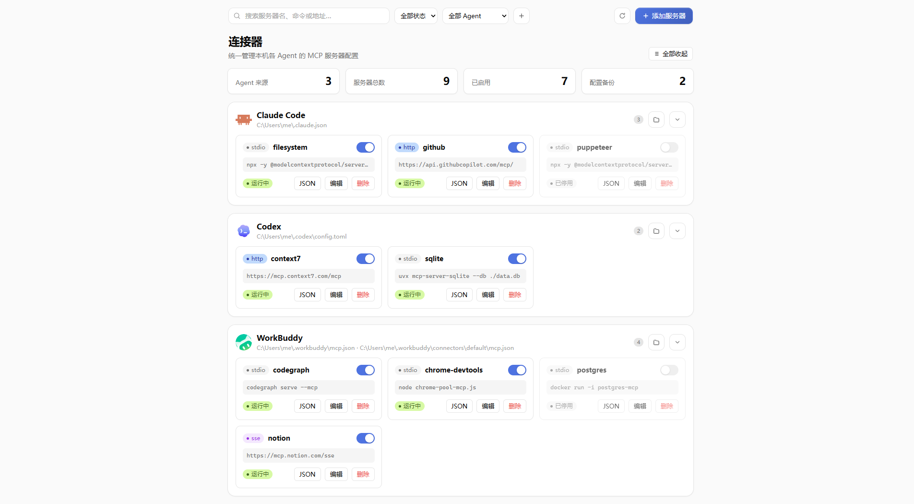
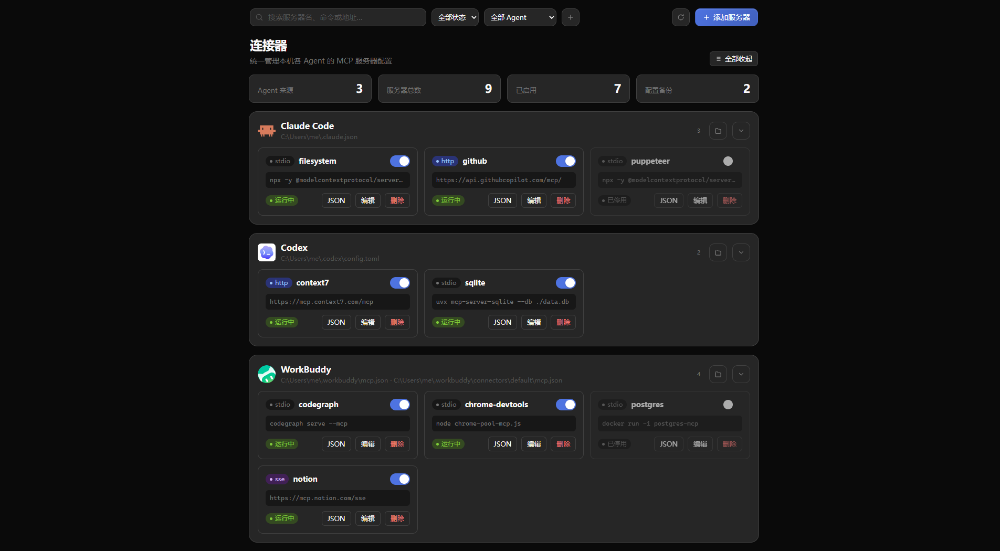

<p align="center">
  
</p>

<h1 align="center">DSH MCP Connectors</h1>

<p align="center">
  在 DeepSeek Harness 里统一管理本机各个 AI Agent 的 MCP 服务器。<br/>
  Manage MCP servers across every local AI agent — directly inside DeepSeek Harness.
</p>

<p align="center">
  <a href="README.zh-CN.md">简体中文</a> · <b>English</b> ·
  <a href="https://www.npmjs.com/package/dsh-mcp-connectors">npm</a>
</p>



## Why

Every AI agent keeps its own MCP config in its own file, in its own format. Finding out which servers are running, and toggling one off for a single tool, means hand-editing JSON and remembering which file belongs to whom.

This plugin auto-discovers those files, shows them in one panel, and lets you toggle, add, edit and delete servers — backing up every file before it is written, with one-click rollback.

## Features

- **Auto-discovery** — scans `~`, `%APPDATA%` and `%LOCALAPPDATA%` (macOS/Linux equivalents included), identifies configs by file name **and** content (`mcpServers` / `mcp` keys, `[mcp_servers]` sections). First scan ≈250 ms on a typical dev machine, then cached.
- **Multi-format support** — JSON (`mcpServers`), OpenCode-style (`mcp`), Codex TOML (`[mcp_servers.*]`), DSH's `cordis.patch.yml` (`@deepseek-ai/dsh-mcp-client` entries), and JSONC (comments / trailing commas). TOML and YAML are rewritten entry-by-entry so comments and unrelated settings survive byte-for-byte.
- **Safe writes** — every write snapshots the original file into `~/.dsh/mcp-connectors/backups/` (last 100 kept). Restore any version with one click; the restore itself is backed up too.
- **Enable / disable** — MCP has no cross-tool `disabled` flag, so disabling removes the entry from the config and keeps its definition in the manager state; enabling writes it back.
- **Product grouping** — tools that split their config across files (e.g. WorkBuddy user-level + connectors) render as one card, each server still bound to its own file.
- **Connector catalog** — three sources: the official [MCP Registry](https://registry.modelcontextprotocol.io/) (live search + paging), the [mcp.so Top 100](https://mcp.so/zh/rankings/servers) (details and install, with an offline cache), and the local **WorkBuddy official connector marketplace** (MCP connectors install back into WorkBuddy; CLI connectors are browse-only). Pick target agents, fill in parameters, install in one click; installed entries can be toggled or uninstalled in place. Every entry has a detail view (repository / website, README, launch command, environment, parameters). If all online sources are unavailable and WorkBuddy is not installed, the 7 built-in reference implementations appear as an offline fallback.
- **Drag to reorder** — display-only ordering stored in plugin state; config files are never touched.
- **Panel that fits the settings page** — vertical layout, sticky section headers, collapsible groups, status/agent filters, back-to-top, and light/dark that follows the host theme.



## Supported configs

| Agent | Path | Format |
| --- | --- | --- |
| DSH | `~/.dsh/profiles/<profile>/cordis.patch.yml` | YAML `@deepseek-ai/dsh-mcp-client` entries |
| DSH (legacy) | `~/.dsh/mcp.json` | JSON `mcpServers` |
| Claude Code | `~/.claude.json` | JSON `mcpServers` |
| Codex | `~/.codex/config.toml` | TOML `[mcp_servers.*]` |
| Cursor | `~/.cursor/mcp.json` | JSON `mcpServers` |
| Gemini | `~/.gemini/settings.json` | JSON `mcpServers` |
| Google Antigravity | `~/.gemini/config/mcp_config.json` | JSON `mcpServers` |
| Qwen Code | `~/.qwen/settings.json` | JSON `mcpServers` |
| Kimi Code | `~/.kimi-code/config.toml` | TOML |
| AtomCode | `~/.atomcode/mcp.json` | JSON `mcpServers` |
| OpenCode | `~/.config/opencode/opencode.json` | JSON `mcp` |
| Windsurf | `~/.codeium/windsurf/mcp_config.json` | JSON `mcpServers` |
| Trae / Trae CN | `~/.trae/mcp.json`, `~/.trae-cn/mcp.json` | JSON `mcpServers` |
| Qoder | `~/.qoder/mcp.json` | JSON `mcpServers` |
| CodeBuddy / CN | `~/.codebuddy/mcp.json` | JSON `mcpServers` |
| WorkBuddy | `~/.workbuddy/mcp.json`, `~/.workbuddy/connectors/default/mcp.json` | JSON `mcpServers` |
| VS Code | `%APPDATA%/Code/User/mcp.json` | JSONC |
| …and anything else auto-discovered | — | — |

Paths are configurable per source; an override is stored in `~/.dsh/mcp-connectors/state.json`. A source whose file does not exist simply doesn't appear.

## Install

```powershell
dsh plugin --profile web add dsh-mcp-connectors
```

or from GitHub:

```powershell
dsh plugin --profile web add https://github.com/elegant01/dsh-mcp-connectors
```

Restart DSH, then open **Settings → Connectors**. Host routes are registered at startup, so a full restart (tray → quit) is required after upgrading.

## Security

- Every mutating request needs a custom header, `application/json`, and a same-origin `Origin`; the host's `connection.fetch` gate still applies.
- Writes are serialized, and a backup always precedes a write.
- Deleting a server removes only that entry; other keys in the file are preserved (JSON is re-serialized, Codex TOML is rewritten per section, DSH YAML replaces only the target entry's `config:` block).
- Online catalog search only talks to `registry.modelcontextprotocol.io` (results cached for 10 minutes). mcp.so access is limited to its allowed rankings and detail pages (cached for 30 minutes, robots.txt respected, `/search` never touched). WorkBuddy connectors are read from the local marketplace cache. Nothing is installed or run automatically — you confirm the target agents and parameters in the panel.
- WorkBuddy connector installs keep `${VAR}` credential placeholders; real secrets stay in WorkBuddy's own key store and are never written to config by the plugin.

## Development

```bash
npm install
npm run typecheck
npm run build        # lib/ (host unbundled, client bundled for DSH ModuleLoader)
npm test             # full regression suite against a temp HOME
npm run preview      # docs/preview.html — real component with fixture data
```

## Releasing

Publishing is fully automated:

```bash
node scripts/bump.cjs 0.2.0   # bump package.json + lockfile + changelog
git commit -am "chore(release): v0.2.0"
git push origin main
git tag v0.2.0 && git push origin v0.2.0
```

The `publish.yml` workflow runs the full test suite and publishes with [npm Trusted Publishing](https://docs.npmjs.com/trusted-publishers) (GitHub OIDC) — no `NPM_TOKEN`, no OTP, and provenance is signed automatically.

## Icons

Agent brand marks in `assets/agent-icons/` come from [@lobehub/icons](https://github.com/lobehub/lobe-icons) (MIT) and are vendored here; they are inlined into the build, so nothing is loaded from external paths at runtime.

## License

[Apache-2.0](LICENSE)
