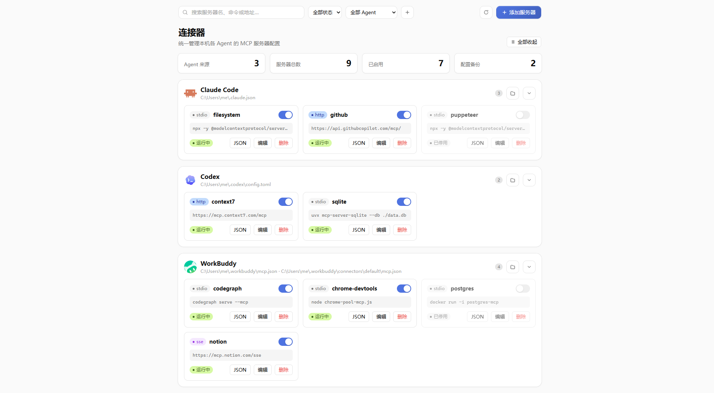
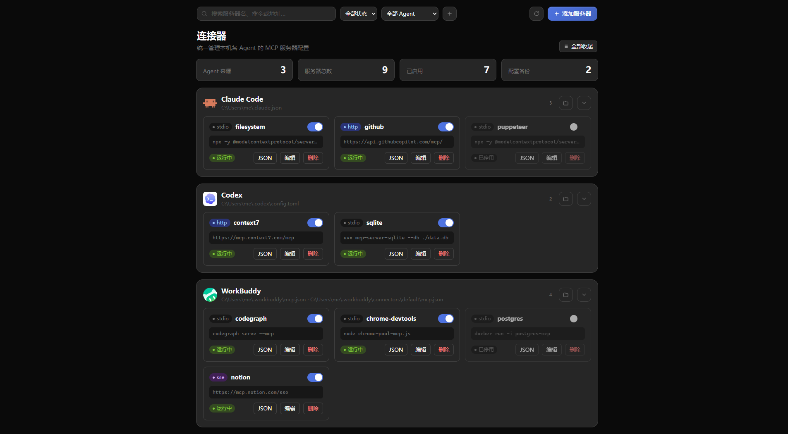

<p align="center">
  
</p>

<h1 align="center">DSH MCP Connectors</h1>

<p align="center">
  在 DeepSeek Harness 里统一管理本机各个 AI Agent 的 MCP 服务器。
</p>

<p align="center">
  <b>简体中文</b> · <a href="README.md">English</a> ·
  <a href="https://www.npmjs.com/package/dsh-mcp-connectors">npm</a>
</p>



## 为什么做这个

每个 AI Agent 都把自己的 MCP 配置放在不同文件、不同格式里。想知道本机到底跑着哪些 server、想单独关掉某一个工具里的某个 server，就得手改 JSON，还得记住哪个文件属于谁。

这个插件把这些文件自动找出来，集中到一个面板里，支持启停、新增、编辑、删除——**每次写文件前自动备份，随时一键回退**。

## 功能

- **自动发现**——扫描 `~`、`%APPDATA%`、`%LOCALAPPDATA%`（macOS / Linux 对应目录同样覆盖），按文件名**和**文件内容双重判据识别（`mcpServers` / `mcp` 键、`[mcp_servers]` 节区）。常规开发机首扫约 250ms，之后走缓存。
- **多格式**——JSON（`mcpServers`）、OpenCode 风格（`mcp`）、Codex TOML（`[mcp_servers.*]` 按节区重写，注释和其它配置逐字节保留）、以及 JSONC（注释 / 尾逗号）。
- **安全写入**——每次写入前把原文件快照到 `~/.dsh/mcp-connectors/backups/`（保留最近 100 份），任意版本一键恢复；恢复前也会先备份当前内容。
- **启停**——各家 MCP 没有统一的 `disabled` 字段，所以停用 = 条目移出配置文件、定义存进管理器状态；启用再写回。
- **产品归组**——配置分散在多个文件里的工具（如 WorkBuddy 用户级 + 连接器）合成一张卡片，但每台 server 仍绑定自己的文件。
- **拖拽排序**——顺序只存在插件状态里，配置文件一个字节都不动。
- **适配设置页的面板**——竖向布局、区块头吸顶、分组可折叠、状态 / Agent 筛选、回到顶部，明暗主题跟随宿主。



## 支持的配置

| Agent | 路径 | 格式 |
| --- | --- | --- |
| DSH | `~/.dsh/mcp.json` | JSON `mcpServers` |
| Claude Code | `~/.claude.json` | JSON `mcpServers` |
| Codex | `~/.codex/config.toml` | TOML `[mcp_servers.*]` |
| Cursor | `~/.cursor/mcp.json` | JSON `mcpServers` |
| Gemini | `~/.gemini/settings.json` | JSON `mcpServers` |
| Google Antigravity | `~/.gemini/config/mcp_config.json` | JSON `mcpServers` |
| Qwen Code | `~/.qwen/settings.json` | JSON `mcpServers` |
| Kimi Code | `~/.kimi-code/config.toml` | TOML |
| AtomCode | `~/.atomcode/mcp.json` | JSON `mcpServers` |
| OpenCode | `~/.config/opencode/opencode.json` | JSON `mcp` |
| Windsurf | `~/.codeium/windsurf/mcp_config.json` | JSON `mcpServers` |
| Trae / Trae CN | `~/.trae/mcp.json`、`~/.trae-cn/mcp.json` | JSON `mcpServers` |
| Qoder | `~/.qoder/mcp.json` | JSON `mcpServers` |
| CodeBuddy / 国内版 | `~/.codebuddy/mcp.json` | JSON `mcpServers` |
| WorkBuddy | `~/.workbuddy/mcp.json`、`~/.workbuddy/connectors/default/mcp.json` | JSON `mcpServers` |
| VS Code | `%APPDATA%/Code/User/mcp.json` | JSONC |
| ……其它自动发现 | — | — |

每个来源的路径都可以在面板里改，覆盖存于 `~/.dsh/mcp-connectors/state.json`。文件不存在的来源不会出现在列表里。

## 安装

```powershell
dsh plugin --profile web add dsh-mcp-connectors
```

或从 GitHub 安装：

```powershell
dsh plugin --profile web add https://github.com/elegant01/dsh-mcp-connectors
```

重启 DSH 后打开 **设置 → 连接器**。后端路由在启动时注册，升级后需要**彻底退出应用**（托盘退出）再启动。

## 安全边界

- 所有写接口要求自定义头 + `application/json` + 同源 `Origin`，宿主 `connection.fetch` 门禁照常生效；
- 写操作串行执行，写前必备份；
- 删除服务器只删目标条目，文件里的其它键原样保留（JSON 重序列化，Codex TOML 按节区重写）。

## 开发

```bash
npm install
npm run typecheck
npm run build        # 生成 lib/（host 不打包，client 打成 DSH ModuleLoader 包）
npm test             # 用临时 HOME 跑全量回归
npm run preview      # docs/preview.html，真实组件 + 假数据
```

## 发版

发布全自动：

```bash
node scripts/bump.cjs 0.2.0   # 同步 package.json + lockfile + changelog
git commit -am "chore(release): v0.2.0"
git push origin main
git tag v0.2.0 && git push origin v0.2.0
```

`publish.yml` 会跑完整测试并用 [npm Trusted Publishing](https://docs.npmjs.com/trusted-publishers)（GitHub OIDC）发布——**不需要 NPM_TOKEN，也不受 OTP 限制**，provenance 自动签名。

## 图标

`assets/agent-icons/` 下的各 Agent 品牌图标取自 [@lobehub/icons](https://github.com/lobehub/lobe-icons)（MIT），已随仓库拷贝并在构建时内联，运行时不依赖任何外部路径。

## 许可证

[Apache-2.0](LICENSE)
